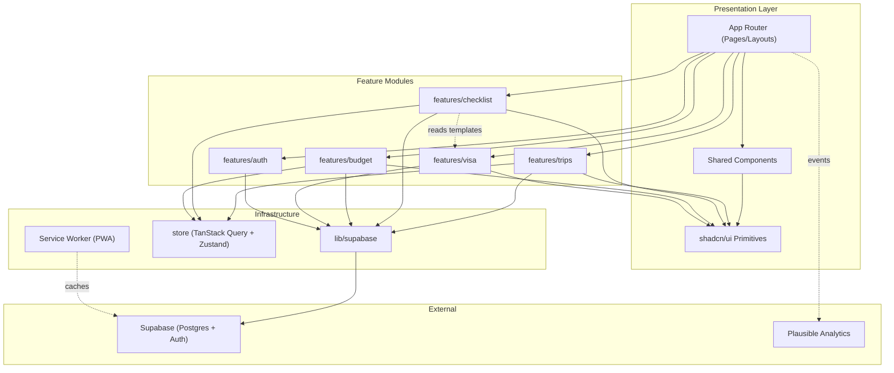
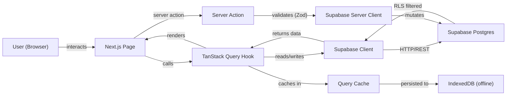
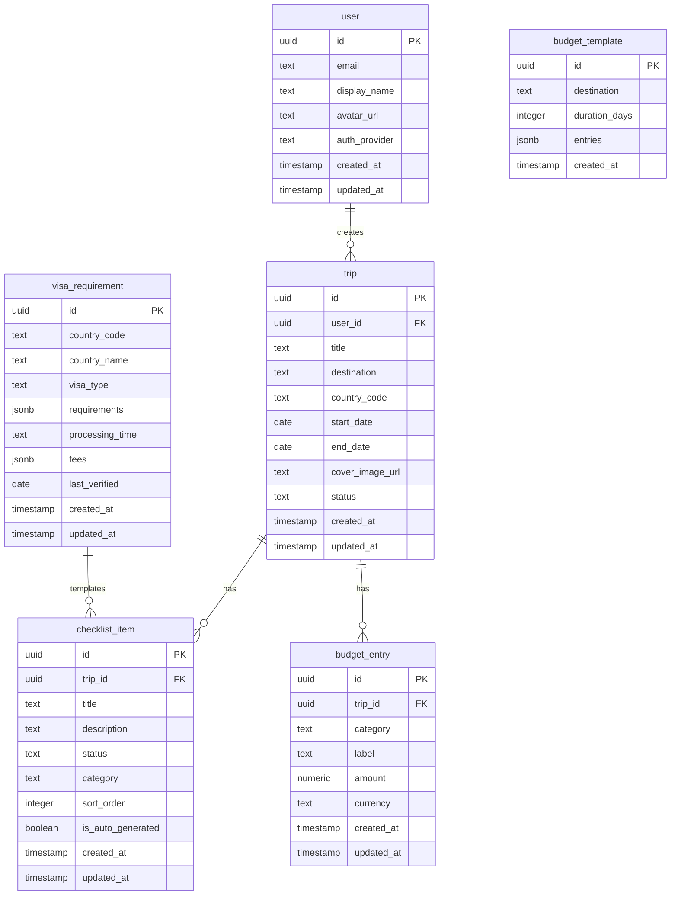

# ITravelista PH — Architecture

> **From Dreaming to Departing**
> An all-in-one travel companion for Filipino tourists traveling abroad.

---

## 1. Project Overview

**ITravelista PH** is a web-first Progressive Web App (PWA) that helps Filipino tourists plan, prepare for, and manage international trips. The MVP focuses on four core features: trip management, smart checklists, peso-denominated budget planning, and curated visa requirement guides.

The application is built as an early-stage startup MVP targeting validation within a 4–6 week sprint by a solo full-stack developer. It prioritizes speed-to-market, mobile-first responsive design, and a clear path toward future native mobile (Expo/React Native) migration.

---

## 2. Project Objectives & Key Features

### Primary Objectives

- Provide Filipino tourists a unified workspace to plan international trips end-to-end
- Eliminate fragmented travel prep (Facebook groups, spreadsheets, multiple apps) with a single cohesive tool
- Deliver curated, PH-passport-specific visa requirement data for top 20–30 destinations
- Validate product-market fit and retention before investing in native mobile apps

### Key Features (MVP)

| Feature | Description |
|---------|-------------|
| **My Trips** | Create and manage trips with destinations, dates, cover images, and countdown badges |
| **Smart Checklist** | Auto-generated pre-trip task lists based on destination + visa requirements, user-customizable |
| **Budget Planner** | Peso-denominated budget tracking with category breakdown, donut chart visualization, and destination templates |
| **Visa Assistant** | Step-by-step visa requirement guides with progress stepper for PH passport holders |

### Target Users

- Filipino tourists planning international leisure trips
- Age 20–45, digitally active, planning 1–4 trips per year
- Currently using Facebook groups, spreadsheets, and multiple disconnected tools

### Non-Goals (MVP)

- AI-powered travel assistant (Phase 2)
- Document Vault with encrypted storage (Phase 3)
- Push notifications / real-time reminders (Phase 3)
- Community / social features (Phase 4)
- Travel guide content curation (Phase 4)
- Multi-user trip collaboration / sharing
- OFW-specific workflows (POEA, OWWA, labor contracts)
- Currency conversion or live exchange rates
- Flight/hotel booking integration

---

## 3. Language & Runtime

| Concern | Choice |
|---------|--------|
| **Language** | TypeScript 5.x (strict mode) |
| **Runtime** | Node.js 20+ LTS |
| **Framework** | Next.js 15+ (App Router) |
| **Package Manager** | pnpm 9+ |
| **Minimum Browser Support** | ES2020 — Chrome 80+, Safari 14+, Firefox 78+, Edge 80+ |

---

## 4. Project Layout

```
itravelista/
├── .agents/                     # Agent workflows, rules, scripts
├── PRD/                         # Product Requirements Document + mockups
├── public/                      # Static assets (icons, images, PWA manifest)
│   ├── icons/                   # PWA icons (various sizes)
│   └── images/                  # Destination cover images
├── src/
│   ├── app/                     # Next.js App Router (pages & layouts)
│   │   ├── (auth)/              # Auth route group (login, signup)
│   │   │   ├── login/
│   │   │   └── signup/
│   │   ├── (main)/              # Authenticated route group
│   │   │   ├── layout.tsx       # Main layout with bottom navigation
│   │   │   ├── page.tsx         # Home / Dashboard
│   │   │   ├── trips/           # My Trips pages
│   │   │   │   ├── page.tsx     # Trip list
│   │   │   │   ├── new/         # Create trip flow
│   │   │   │   └── [id]/        # Trip detail
│   │   │   ├── checklist/       # Smart Checklist pages
│   │   │   │   └── [tripId]/
│   │   │   ├── budget/          # Budget Planner pages
│   │   │   │   └── [tripId]/
│   │   │   └── visa/            # Visa Assistant pages
│   │   │       └── [country]/
│   │   ├── api/                 # API route handlers (if needed)
│   │   ├── layout.tsx           # Root layout (providers, fonts, metadata)
│   │   ├── manifest.ts          # PWA manifest generation
│   │   └── not-found.tsx        # 404 page
│   ├── components/
│   │   ├── ui/                  # shadcn/ui primitives (themed)
│   │   └── shared/              # App-wide shared components
│   │       ├── bottom-nav.tsx   # Bottom navigation bar
│   │       ├── page-header.tsx  # Reusable page header
│   │       └── empty-state.tsx  # Empty state illustrations
│   ├── features/                # Feature modules (self-contained)
│   │   ├── trips/
│   │   │   ├── components/      # Trip-specific UI components
│   │   │   ├── hooks/           # TanStack Query hooks for trips
│   │   │   ├── actions/         # Server actions for trip mutations
│   │   │   ├── types.ts         # Trip types & Zod schemas
│   │   │   └── utils.ts         # Trip utilities (countdown, status)
│   │   ├── checklist/
│   │   │   ├── components/
│   │   │   ├── hooks/
│   │   │   ├── actions/
│   │   │   ├── types.ts
│   │   │   └── templates/       # Auto-generation templates per destination
│   │   ├── budget/
│   │   │   ├── components/
│   │   │   ├── hooks/
│   │   │   ├── actions/
│   │   │   ├── types.ts
│   │   │   └── templates/       # Budget templates per destination
│   │   ├── visa/
│   │   │   ├── components/
│   │   │   ├── hooks/
│   │   │   ├── types.ts
│   │   │   └── data/            # Curated visa requirement JSON files
│   │   └── auth/
│   │       ├── components/      # Auth forms, social buttons
│   │       ├── hooks/           # Auth state hooks
│   │       ├── actions/         # Server actions for auth
│   │       └── types.ts
│   ├── lib/
│   │   ├── supabase/
│   │   │   ├── client.ts        # Browser Supabase client
│   │   │   ├── server.ts        # Server-side Supabase client
│   │   │   ├── middleware.ts    # Auth middleware helper
│   │   │   └── types.ts         # Generated database types
│   │   ├── utils.ts             # General utilities (cn, formatCurrency, etc.)
│   │   └── constants.ts         # App-wide constants
│   ├── store/
│   │   ├── query-client.ts      # TanStack Query client configuration
│   │   └── app-store.ts         # Zustand store (UI state)
│   ├── hooks/
│   │   └── use-offline.ts       # Offline detection hook
│   └── styles/
│       └── globals.css          # Tailwind base, custom CSS tokens
├── supabase/
│   ├── migrations/              # SQL migration files
│   ├── seed.sql                 # Seed data (visa requirements, templates)
│   └── config.toml              # Supabase local dev config
├── tests/
│   ├── unit/                    # Vitest unit tests
│   ├── integration/             # Hook/component integration tests
│   └── e2e/                     # Playwright E2E tests
├── .env.example                 # Environment variable template
├── .eslintrc.json               # ESLint configuration
├── .prettierrc                  # Prettier configuration
├── next.config.ts               # Next.js configuration (PWA, images)
├── tailwind.config.ts           # Tailwind CSS v4 configuration
├── tsconfig.json                # TypeScript configuration (strict)
├── vitest.config.ts             # Vitest configuration
├── playwright.config.ts         # Playwright configuration
├── Dockerfile                   # Production Docker image
├── docker-compose.yml           # Local dev (Supabase, app)
└── package.json
```

---

## 5. Module Boundaries

### `features/trips`

| Concern | Detail |
|---------|--------|
| **Owns** | Trip entity CRUD, trip list/detail views, countdown calculation, trip status transitions, cover image selection |
| **Does NOT own** | Checklist items (→ `checklist`), budget entries (→ `budget`), visa data (→ `visa`) |
| **Interfaces** | `TripService` — `createTrip()`, `updateTrip()`, `deleteTrip()`, `getTrips()`, `getTripById()` |
| **Mock Availability** | MSW handlers mock Supabase responses for all trip queries/mutations |

### `features/checklist`

| Concern | Detail |
|---------|--------|
| **Owns** | ChecklistItem entity CRUD, checklist views, filter/sort, auto-generation from templates, status tracking |
| **Does NOT own** | Trip metadata (→ `trips`), visa requirement definitions (→ `visa`), but reads visa templates for auto-generation |
| **Interfaces** | `ChecklistService` — `getItems()`, `createItem()`, `updateItem()`, `deleteItem()`, `generateFromDestination()` |
| **Mock Availability** | MSW handlers for Supabase + mock template data for auto-generation tests |

### `features/budget`

| Concern | Detail |
|---------|--------|
| **Owns** | BudgetEntry entity CRUD, budget views, donut chart component, category totals, destination templates |
| **Does NOT own** | Trip metadata (→ `trips`), currency conversion (deferred) |
| **Interfaces** | `BudgetService` — `getEntries()`, `createEntry()`, `updateEntry()`, `deleteEntry()`, `applyTemplate()`, `getCategoryTotals()` |
| **Mock Availability** | MSW handlers + mock template data |

### `features/visa`

| Concern | Detail |
|---------|--------|
| **Owns** | VisaRequirement entity, curated visa data (JSON), requirement list views, progress stepper, destination lookup |
| **Does NOT own** | Checklist items (→ `checklist`), trip management (→ `trips`) |
| **Interfaces** | `VisaService` — `getRequirements()`, `getByCountry()`, `getDestinations()` |
| **Mock Availability** | Mock JSON data files for testing |

### `features/auth`

| Concern | Detail |
|---------|--------|
| **Owns** | Authentication flows (Google OAuth, magic link, email/password, guest), session state, auth middleware, protected routes |
| **Does NOT own** | User profile details beyond auth identity, authorization/permissions |
| **Interfaces** | `AuthService` — `signIn()`, `signUp()`, `signOut()`, `getSession()`, `onAuthStateChange()` |
| **Mock Availability** | Mock Supabase auth client for testing |

### `components/ui`

| Concern | Detail |
|---------|--------|
| **Owns** | shadcn/ui themed components, design system tokens (colors, spacing, typography), layout primitives |
| **Does NOT own** | Feature-specific views, business logic |
| **Interfaces** | React component props — standard shadcn/ui API surface |
| **Mock Availability** | N/A (presentational components, tested via component tests) |

### `lib/supabase`

| Concern | Detail |
|---------|--------|
| **Owns** | Supabase client initialization (browser + server), auth middleware helper, generated database types |
| **Does NOT own** | Business logic, query construction (→ feature hooks) |
| **Interfaces** | `createBrowserClient()`, `createServerClient()` — factory functions |
| **Mock Availability** | MSW intercepts all Supabase HTTP calls at the network layer |

---

## 6. Dependency Direction Rules

| Module | May Import | Must NOT Import |
|--------|-----------|-----------------|
| `app/(main)/*` pages | `features/*`, `components/*`, `lib/*`, `store/*` | — (top of dependency tree) |
| `app/(auth)/*` pages | `features/auth`, `components/*`, `lib/*` | `features/trips`, `features/checklist`, `features/budget`, `features/visa` |
| `features/trips` | `lib/*`, `store/*`, `components/ui`, `types/*` | `features/checklist`, `features/budget`, `features/visa`, `features/auth` |
| `features/checklist` | `lib/*`, `store/*`, `components/ui`, `types/*`, `features/visa/data/*` (read-only templates) | `features/trips`, `features/budget`, `features/auth` |
| `features/budget` | `lib/*`, `store/*`, `components/ui`, `types/*` | `features/trips`, `features/checklist`, `features/visa`, `features/auth` |
| `features/visa` | `lib/*`, `store/*`, `components/ui`, `types/*` | `features/trips`, `features/checklist`, `features/budget`, `features/auth` |
| `features/auth` | `lib/*`, `store/*`, `components/ui` | `features/trips`, `features/checklist`, `features/budget`, `features/visa` |
| `components/shared` | `components/ui`, `lib/utils` | `features/*`, `store/*`, `app/*` |
| `components/ui` | — (leaf components, no internal imports) | Everything |
| `lib/*` | `types/*` only | `features/*`, `components/*`, `app/*`, `store/*` |
| `store/*` | `lib/*`, `types/*` | `features/*`, `components/*`, `app/*` |

> **Exception:** `features/checklist` may import from `features/visa/data/` (curated visa template JSON) for auto-generation. This is a read-only data dependency, not a code coupling.

---

## 7. Toolchain

| Tool | Purpose | Command |
|------|---------|---------|
| **pnpm** | Package manager | `pnpm install` |
| **Next.js** (Turbopack) | Dev server | `pnpm dev` |
| **TypeScript** | Type checking | `pnpm type-check` → `tsc --noEmit` |
| **ESLint** | Linting | `pnpm lint` → `next lint` |
| **Prettier** | Formatting | `pnpm format:check` → `prettier --check .` |
| **Vitest** | Unit/integration tests | `pnpm test` → `vitest run` |
| **React Testing Library** | Component tests | (via Vitest) |
| **Playwright** | E2E tests | `pnpm test:e2e` → `playwright test` |
| **Supabase CLI** | Local DB + type gen | `supabase start`, `supabase gen types typescript` |

### Verification Pipeline (must all exit 0)

```
pnpm type-check
pnpm lint
pnpm format:check
pnpm test
pnpm build
```

---

## 8. Error Handling Strategy

### Pattern: Result Objects

All server actions and data-fetching functions return typed result objects:

```typescript
type Result<T> = { data: T; error: null } | { data: null; error: AppError };

interface AppError {
  code: string;       // Machine-readable: "TRIP_NOT_FOUND", "VALIDATION_ERROR"
  message: string;    // User-friendly message
  details?: unknown;  // Optional debug info (stripped in production)
}
```

This mirrors Supabase's `{ data, error }` response pattern for consistency.

### Per-Feature Error Types

| Feature | Error Codes |
|---------|------------|
| `trips` | `TRIP_NOT_FOUND`, `TRIP_CREATE_FAILED`, `TRIP_LIMIT_REACHED` |
| `checklist` | `ITEM_NOT_FOUND`, `ITEM_CREATE_FAILED`, `TEMPLATE_NOT_FOUND` |
| `budget` | `ENTRY_NOT_FOUND`, `ENTRY_CREATE_FAILED`, `INVALID_AMOUNT` |
| `visa` | `COUNTRY_NOT_FOUND`, `DATA_UNAVAILABLE` |
| `auth` | `AUTH_FAILED`, `SESSION_EXPIRED`, `INVALID_CREDENTIALS` |

### Error Boundaries

- **Root**: `app/error.tsx` — catches unhandled errors, shows recovery UI
- **Per-route**: `app/(main)/trips/error.tsx` — feature-specific error UI
- **Form validation**: Zod schemas validate at the boundary before server actions execute
- **Client queries**: TanStack Query `isError` / `error` states render inline error messages

---

## 9. Observability & Logging

### MVP Approach (Lightweight)

| Layer | Tool | Purpose |
|-------|------|---------|
| **Analytics** | Plausible (self-hosted) | Page views, custom events |
| **Error Tracking** | `console.error` + Sentry free tier (optional) | Runtime errors |
| **Performance** | Web Vitals (Next.js built-in) | Core Web Vitals monitoring |

### Custom Events (Plausible)

| Event | When Fired |
|-------|-----------|
| `trip_created` | User creates a new trip |
| `checklist_generated` | Auto-generated checklist for a destination |
| `checklist_completed` | All items checked off |
| `budget_set` | User sets a trip budget |
| `budget_template_applied` | User applies a destination template |
| `visa_viewed` | User views visa requirements for a country |
| `auth_signup` | New user registration |
| `pwa_installed` | PWA added to home screen |

### Log Levels

- **Development**: `debug` — verbose, all Supabase queries logged
- **Production**: `warn` — errors and warnings only, no PII in logs

---

## 10. Testing Strategy

| Level | Tool | Location | Scope |
|-------|------|----------|-------|
| **Unit** | Vitest | `tests/unit/`, co-located `*.test.ts` | Utilities, data transformations, business logic, Zod schemas |
| **Component** | Vitest + RTL | `tests/integration/` | Component behavior, hook integration with mocked Supabase |
| **E2E** | Playwright | `tests/e2e/` | Critical user flows: signup → create trip → add checklist → set budget |
| **API Mock** | MSW (Mock Service Worker) | `tests/mocks/` | Intercept Supabase REST/Auth calls for deterministic testing |

### Coverage Targets (MVP)

- **Business logic** (utils, templates, calculations): 80%+
- **Hooks** (data fetching, mutations): 60%+
- **UI components**: No hard target — test critical interactions only
- **E2E flows**: 3–5 critical paths covered

### What NOT to Test

- shadcn/ui primitives (tested upstream)
- Supabase client internals (tested by Supabase)
- CSS / visual styling (use visual review, not snapshot tests)

---

## 11. Documentation Conventions

- **TSDoc** on all exported functions, types, and interfaces
- **README.md** at project root: setup, environment, development workflow
- **Feature README**: Brief header comment in each feature's `types.ts` explaining the module's purpose
- **Inline comments**: Only for non-obvious logic ("why", not "what")
- **API routes**: Request/response types serve as documentation via TypeScript
- **Changelog**: Not required for MVP — git log suffices

---

## 12. Dependencies & External Systems

### Core Dependencies

| Package | Purpose | Version |
|---------|---------|---------|
| `next` | Framework | 15.x |
| `react` / `react-dom` | UI library | 19.x |
| `@supabase/supabase-js` | Database client | 2.x |
| `@supabase/ssr` | Server-side auth helpers | Latest |
| `@tanstack/react-query` | Server state management | 5.x |
| `zustand` | Client state management | 5.x |
| `zod` | Schema validation | 3.x |
| `tailwindcss` | Styling | 4.x |
| `recharts` or `@visx/visx` | Donut chart visualization | Latest |
| `date-fns` | Date utilities | 4.x |
| `@serwist/next` | PWA service worker | Latest |
| `lucide-react` | Icon set | Latest |

### External Systems

| System | Purpose | Auth Method |
|--------|---------|-------------|
| **Supabase** (Postgres) | Primary database + auth + storage | Anon key (client), Service role key (server) |
| **Plausible** (self-hosted) | Analytics | Domain-based (no auth needed) |

### No External APIs at MVP

Visa data is statically curated. No live API integrations.

---

## 13. Architecture Diagrams

### Module Interaction Diagram



### Data Flow Diagram



### Entity-Relationship Diagram



---

## 14. Known Constraints & Technical Debt

| # | Constraint | Impact | Planned Resolution |
|---|-----------|--------|-------------------|
| 1 | Visa data is statically curated JSON | Data may become stale; manual update burden | Phase 2: automated scraping pipeline or API integration |
| 2 | Offline support is read-only cache | Users cannot create/edit trips offline | Native app phase: full local-first sync with CRDTs |
| 3 | No AI assistant | Missing key differentiator from PRD | Phase 2: LLM integration with RAG over visa data |
| 4 | Budget templates are hardcoded JSON | No admin panel for template management | Post-MVP: admin dashboard or CMS |
| 5 | No image upload for trip covers | Users select from preset destination images | Phase 2: Supabase Storage upload flow |
| 6 | Guest mode data is ephemeral | Data lost on browser cache clear | Prompt guest users to sign up; migrate local data on signup |
| 7 | No push notifications | No deadline reminders | Native app phase: FCM/APNs |
| 8 | Single-user only | No trip sharing or collaboration | Phase 2: read-only share links |
| 9 | No SSR for dynamic content | First load may flash loading states | Acceptable for PWA; optimize with prefetching |

---

## 15. Data Model

### Tables

#### `user` (extends Supabase `auth.users`)

| Column | Type | Constraints | Notes |
|--------|------|-------------|-------|
| `id` | UUID | PK, references `auth.users(id)` | Supabase Auth managed |
| `email` | TEXT | NOT NULL, UNIQUE | From auth provider |
| `display_name` | TEXT | | User's display name |
| `avatar_url` | TEXT | | Profile photo URL |
| `auth_provider` | TEXT | NOT NULL | `google`, `email`, `magic_link`, `guest` |
| `created_at` | TIMESTAMPTZ | NOT NULL, DEFAULT `now()` | |
| `updated_at` | TIMESTAMPTZ | NOT NULL, DEFAULT `now()` | |

#### `trip`

| Column | Type | Constraints | Notes |
|--------|------|-------------|-------|
| `id` | UUID | PK, DEFAULT `gen_random_uuid()` | |
| `user_id` | UUID | FK → `user(id)`, NOT NULL, ON DELETE CASCADE | |
| `title` | TEXT | NOT NULL | e.g., "Japan Trip" |
| `destination` | TEXT | NOT NULL | e.g., "Tokyo, Osaka, Kyoto" |
| `country_code` | TEXT | NOT NULL | ISO 3166-1 alpha-2 (e.g., "JP") |
| `start_date` | DATE | NOT NULL | |
| `end_date` | DATE | NOT NULL | |
| `cover_image_url` | TEXT | | Preset destination image |
| `status` | TEXT | NOT NULL, DEFAULT `'planning'` | `planning`, `upcoming`, `in_progress`, `completed` |
| `created_at` | TIMESTAMPTZ | NOT NULL, DEFAULT `now()` | |
| `updated_at` | TIMESTAMPTZ | NOT NULL, DEFAULT `now()` | |

RLS: `user_id = auth.uid()`

#### `checklist_item`

| Column | Type | Constraints | Notes |
|--------|------|-------------|-------|
| `id` | UUID | PK, DEFAULT `gen_random_uuid()` | |
| `trip_id` | UUID | FK → `trip(id)`, NOT NULL, ON DELETE CASCADE | |
| `title` | TEXT | NOT NULL | e.g., "Passport (valid for 6+ months)" |
| `description` | TEXT | | Optional details or link |
| `status` | TEXT | NOT NULL, DEFAULT `'todo'` | `todo`, `in_progress`, `completed` |
| `category` | TEXT | NOT NULL, DEFAULT `'general'` | `documents`, `booking`, `insurance`, `money`, `general` |
| `sort_order` | INTEGER | NOT NULL, DEFAULT `0` | For drag-to-reorder |
| `is_auto_generated` | BOOLEAN | NOT NULL, DEFAULT `false` | True if created by template |
| `created_at` | TIMESTAMPTZ | NOT NULL, DEFAULT `now()` | |
| `updated_at` | TIMESTAMPTZ | NOT NULL, DEFAULT `now()` | |

RLS: via `trip.user_id = auth.uid()` (join through trip)

#### `budget_entry`

| Column | Type | Constraints | Notes |
|--------|------|-------------|-------|
| `id` | UUID | PK, DEFAULT `gen_random_uuid()` | |
| `trip_id` | UUID | FK → `trip(id)`, NOT NULL, ON DELETE CASCADE | |
| `category` | TEXT | NOT NULL | `flights`, `accommodation`, `food`, `transportation`, `activities`, `other` |
| `label` | TEXT | NOT NULL | e.g., "AirAsia roundtrip" |
| `amount` | NUMERIC(12,2) | NOT NULL, CHECK `amount >= 0` | In PHP (₱) |
| `currency` | TEXT | NOT NULL, DEFAULT `'PHP'` | ISO 4217 |
| `created_at` | TIMESTAMPTZ | NOT NULL, DEFAULT `now()` | |
| `updated_at` | TIMESTAMPTZ | NOT NULL, DEFAULT `now()` | |

RLS: via `trip.user_id = auth.uid()` (join through trip)

#### `budget_template` (seeded, not user-editable)

| Column | Type | Constraints | Notes |
|--------|------|-------------|-------|
| `id` | UUID | PK, DEFAULT `gen_random_uuid()` | |
| `destination` | TEXT | NOT NULL, UNIQUE | e.g., "Japan" |
| `duration_days` | INTEGER | NOT NULL | e.g., 7 |
| `entries` | JSONB | NOT NULL | Array of `{ category, label, amount }` |
| `created_at` | TIMESTAMPTZ | NOT NULL, DEFAULT `now()` | |

RLS: Public read-only (no user_id needed)

#### `visa_requirement` (seeded, not user-editable at MVP)

| Column | Type | Constraints | Notes |
|--------|------|-------------|-------|
| `id` | UUID | PK, DEFAULT `gen_random_uuid()` | |
| `country_code` | TEXT | NOT NULL, UNIQUE | ISO 3166-1 alpha-2 |
| `country_name` | TEXT | NOT NULL | |
| `visa_type` | TEXT | NOT NULL | `visa_free`, `visa_on_arrival`, `e_visa`, `embassy_visa` |
| `requirements` | JSONB | NOT NULL | Array of `{ item, description, required }` |
| `processing_time` | TEXT | | e.g., "5-7 business days" |
| `fees` | JSONB | | `{ currency, amount, notes }` |
| `last_verified` | DATE | NOT NULL | When data was last manually verified |
| `created_at` | TIMESTAMPTZ | NOT NULL, DEFAULT `now()` | |
| `updated_at` | TIMESTAMPTZ | NOT NULL, DEFAULT `now()` | |

RLS: Public read-only

### Relationship Summary

- `user` 1:N `trip` — CASCADE delete
- `trip` 1:N `checklist_item` — CASCADE delete
- `trip` 1:N `budget_entry` — CASCADE delete
- `visa_requirement` provides template data to `checklist_item` (logical, not FK)

### Migration Strategy

- **Tool**: Supabase CLI (`supabase migration new`, `supabase db push`)
- **Naming**: `YYYYMMDDHHMMSS_description.sql` (Supabase default format)
- **Rollback**: Each migration includes a `-- reverse:` comment block with rollback SQL
- **State tracking**: Supabase manages migration history in `supabase_migrations.schema_migrations`
- **Seed data**: `supabase/seed.sql` — budget templates + visa requirements for top 20 destinations

### Naming Conventions

- `snake_case` for all table and column names
- Singular table names (`trip`, not `trips`)
- FK columns: `{referenced_table}_id` (e.g., `user_id`, `trip_id`)

---

## 16. Environment Configuration

### Environments

| Environment | Purpose | Config Source |
|-------------|---------|---------------|
| **Dev** | Local development | `.env.local` + Supabase CLI (local instance) |
| **Staging** | Pre-production testing | Coolify env vars + Supabase project (staging) |
| **Prod** | Production | Coolify env vars + Supabase project (prod) |

### Environment Variables

| Variable | Type | Required | Default | Notes |
|----------|------|:--------:|---------|-------|
| `NEXT_PUBLIC_SUPABASE_URL` | String | ✅ | — | Supabase project URL |
| `NEXT_PUBLIC_SUPABASE_ANON_KEY` | String | ✅ | — | Supabase anonymous/public API key |
| `SUPABASE_SERVICE_ROLE_KEY` | String | ✅ | — | Server-side only, admin access |
| `NEXT_PUBLIC_APP_URL` | String | ✅ | `http://localhost:3000` | Base URL for OAuth redirects |
| `NEXT_PUBLIC_PLAUSIBLE_DOMAIN` | String | ❌ | — | Plausible analytics domain |
| `NEXT_PUBLIC_PLAUSIBLE_HOST` | String | ❌ | — | Self-hosted Plausible URL |

### Secrets Management

- **Dev**: `.env.local` (git-ignored)
- **Staging/Prod**: Coolify environment variables (encrypted at rest)
- `SUPABASE_SERVICE_ROLE_KEY` is NEVER exposed to the browser (server-side only)

### Docker Compose (Local Dev)

```yaml
# docker-compose.yml
services:
  app:
    build: .
    ports:
      - "3000:3000"
    env_file: .env.local
    depends_on:
      - supabase
  # Supabase local development handled by `supabase start` CLI
  # No need for manual Docker Supabase setup
```

> **Note:** For local development, `supabase start` (via Supabase CLI) manages the Postgres + Auth + Storage containers. The Docker Compose file is primarily for production-like builds.
