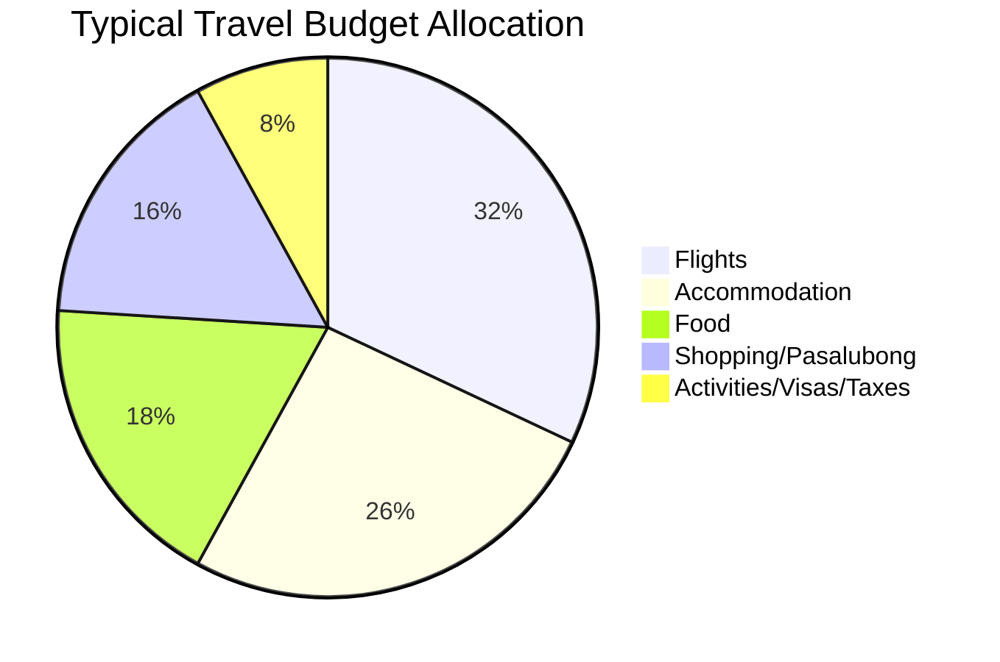

# Philippine Outbound Travel Market Opportunity

## 1. Executive Summary

The Philippine outbound travel market is experiencing robust, sustained growth, driven by post-pandemic recovery, rising middle-class disposable income, and increasing accessibility of short-haul Asian destinations. In 2024, Filipino international departures surged by 37.5% year-over-year, reaching over 8.3 million departures with ₱345.68 billion in travel expenditure. Projected to surpass 9.6 million departures by the end of 2026, this market represents a highly lucrative but structurally underserved segment.

Despite this explosive growth, the Filipino traveler faces a unique set of bureaucratic, financial, and psychological hurdles—the "compliance funnel"—that global travel platforms completely ignore. From managing fragmented documentation like the eTravel QR, TIEZA receipts, and extensive visa requirements, to navigating extreme anxiety regarding immigration offloading, the friction is immense. 

**ITravelista PH** is uniquely positioned to bridge this gap. By building a unified, offline-first travel companion app tailored specifically to the Filipino context, we can capture significant market share, transform the outbound travel experience, and establish ourselves as the definitive platform for the modern Filipino traveler.

## 2. Market Size & Growth

The outbound travel sector has demonstrated remarkable resilience and acceleration. The consistent year-over-year growth in both departure volume and expenditure highlights a market moving from recovery into expansion.

### Outbound Departures & Expenditure (Filipino Citizens)

| Year | Total Departures (M) | YoY Growth | Total Expenditure (₱ Billion) | YoY Growth |
| :--- | :--- | :--- | :--- | :--- |
| **2023** | ~6.90 | - | 208.25 | - |
| **2024** | 8.35 | +37.5% | 345.68 | +66.0% |
| **2025** | ~8.95 | +3.5% | 357.93 | +3.5% |
| **2026 (Proj)** | ~9.60+ | +7.3% | 380.00+ | +6.2% |

> **Note:** Q1 2026 momentum shows 2.74M departures, representing a 14.6% YoY increase, indicating that the 2026 projections may be conservative. Total outbound departures (all nationalities) reached 15.05M in 2024 and are projected to hit 17.5M by 2026.

## 3. Filipino Traveler Demographics & Behavior

Filipino travelers are highly connected, socially motivated, and exceptionally price-conscious.
- **Deal-Seeking Leaders:** Filipinos lead the APAC region in deal-seeking behavior, with 59% actively hunting for promotions and discounts.
- **Planning Horizon:** The typical booking window is 1 to 3 months ahead of the departure date, reflecting a deliberate approach to budgeting and compliance gathering.
- **Social & VFR Driven:** Travel is heavily influenced by social media aesthetics, pop culture (K-pop/K-drama), and Visiting Friends and Relatives (VFR).

## 4. Top Destinations & Spending Patterns

The market is heavily skewed towards short-haul Asian destinations due to favorable visa policies and the proliferation of Low-Cost Carriers (LCCs).

### Top Destinations
1. **Hong Kong:** Captures 30-35% of the leisure share. Driven by 14-day visa-free entry, LCC availability, and family attractions like Disneyland.
2. **Japan:** Tokyo, Osaka/Kyoto, Hokkaido. Fueled by a weak Yen and the introduction of an eVisa pilot program.
3. **Singapore:** 30-day visa-free access. Key driver for concert tourism and Universal Studios.
4. **Taiwan:** 14-day visa-free entry recently extended to July 31, 2027.
5. **Thailand & Vietnam:** Thailand (Bangkok/Phuket) offers visa-free access; Vietnam (Da Nang/Hanoi) is the fastest-growing budget destination.
6. **South Korea:** Driven heavily by K-pop/K-drama and recent credit card-based visa waivers.
7. **US & Canada:** Dominated by long-haul VFR traffic.

### Average Spending Patterns
- **Short-Haul Asia (4-7 days):** ₱42,000 - ₱68,000 ($750 - $1,200)
- **Long-Haul (US/Europe):** ₱150,000 - ₱250,000+ ($2,600 - $4,400)

**Expenditure Breakdown:**

## 5. Filipino Traveler Pain Points: The Compliance Funnel

The Filipino travel experience is defined by high friction and systemic anxiety. We categorize this as the "Compliance Funnel."

1. **Visa Application:** Gathering complex documentation including Average Daily Balance (ADB) calculations, Income Tax Returns (ITR), Certificates of Employment (COE), and Affidavits of Support.
2. **Pre-Departure Compliance:** Navigating the mandatory ₱1,620 TIEZA Travel Tax and securing the eTravel QR code within 72 hours of departure.
3. **Immigration Gate Anxiety:** The fear of Bureau of Immigration (BI) offloading and secondary inspections is a uniquely Filipino psychological burden.
4. **In-Transit Budgeting:** Managing PHP forex spreads, dealing with Dynamic Currency Conversion (DCC) traps, and tracking multi-currency expenses across GCash, Maya, and traditional banks.
5. **On-Ground Execution:** Struggling with offline itineraries and navigating eSIM/roaming connectivity gaps.

> [!WARNING]
> **Document Fragmentation:** Travelers currently juggle 5-8 disconnected apps (eTravel, TIEZA portal, airline apps, Klook vouchers, insurance policies, passport backups) just to clear the airport. 

## 6. Philippine Digital & Fintech Infrastructure

The Philippines is a mobile-first, hyper-social market with mature fintech adoption, providing a perfect foundation for a comprehensive travel app.

- **Connectivity:** 98.0M internet users (83.8% penetration) with 137.0M active mobile lines. Over 95% access the web via smartphones.
- **Social Media:** Users spend 3.5+ hours daily on social media, among the highest globally.
- **Fintech Dominance:**
  - **GCash:** 94M+ users. Features Alipay+ integration for cross-border QR payments (Japan/Korea/Singapore/Europe) and Visa cards with zero FX markup.
  - **Maya:** 50M+ users. Offers competitive FX rates and advanced in-app card controls.
  - **Digital Banks:** GoTyme, SeaBank, and Tonik are aggressively replacing traditional banks for travel-specific savings and spending.

*Strategic Recommendation:* ITravelista PH must prioritize seamless integration with GCash and Maya, while ensuring robust **offline Progressive Web App (PWA) capabilities** for use in subways, flights, and remote areas.

## 7. The OFW & Diaspora Segment

The ~10 million Filipinos overseas represent a massive, specialized segment with distinct needs.

- **VFR & Sponsored Travel:** 2.19M OFW homecomings annually (peaking during Pasko and Holy Week). OFWs frequently sponsor international trips for their families, often meeting in hubs like Hong Kong, Bangkok, or Singapore.
- **Bureaucratic Needs:** Sponsored travel requires specific documentation like the Affidavit of Support & Guarantee (AOSG) and proof of relationship docs.
- **Exemptions:** OFWs navigate specific processes for Travel Tax exemption via the OEC/DMW OFW Pass.
- **Layover Tourism:** High demand for 24-72 hour exploration guides in major transit hubs (Dubai, Doha, Singapore Changi, Incheon).

## 8. Regulatory Landscape

Understanding the regulatory environment is critical for building features that solve real compliance pain points.

- **Passport Power:** The Philippine passport ranks 72nd on the Henley Passport Index, with access to 65 visa-free or Visa-On-Arrival (VOA) destinations.
- **Visa Relaxations:** 
  - Taiwan extended its visa-free policy through July 31, 2027.
  - South Korea waived financial documents for Gold/Platinum cardholders (BDO, BPI, RCBC, Metrobank) through Dec 31, 2026, removing the 3-month bank statement requirement.
  - Japan operates an eVisa system for package tour travelers via accredited agencies.
  - ASEAN countries offer 14-30 days visa-free.
- **Government Digital Systems:**
  - **eTravel (etravel.gov.ph):** Mandatory electronic declaration generating a QR code within 72 hours of travel.
  - **TIEZA Travel Tax:** ₱1,620 economy / ₱2,700 first/business, payable via airline/TIEZA portal/GCash/Maya.
  - **DFA:** Digital transition with Passport OAS, E-Passport renewal kiosks, and digital Apostilles.

## 9. The Market Gap — Why Now?

There is currently **no dedicated Filipino-tailored outbound travel companion app**. 

- **The Workaround Economy:** Filipinos rely on heavily fragmented, manual systems: sprawling Google Sheets, generic global OTAs, and crowdsourced advice from Facebook DIY travel groups (which boast 1M+ members).
- **The Global Blindspot:** Global platforms focus purely on booking transactions. They completely ignore the bureaucratic, psychological, and financial anxiety inherent to the Filipino border crossing experience.
- **Domestic Focus:** The government's official "Travel Philippines" app is entirely focused on domestic tourism.

**Actionable Insight:** ITravelista PH's core value proposition is not just booking—it is **compliance, organization, and peace of mind**. By digitizing the "Workaround Economy," we capture the entire traveler lifecycle.

## 10. Total Addressable Market (TAM) Estimation

Based on 2026 projections:

- **Total Outbound Departures (Filipino Citizens):** ~9.60 Million
- **Total Expenditure:** ~₱380 Billion

If ITravelista PH targets a conservative **10%** of the outbound citizen market:
- **Serviceable Obtainable Market (SOM):** ~960,000 travelers annually.
- **Addressable Spend Segment:** ₱38 Billion.

By providing premium features, affiliate integrations (eSIMs, insurance, Klook activities), and fintech partnerships, the monetization surface area within this highly engaged SOM is massive.
