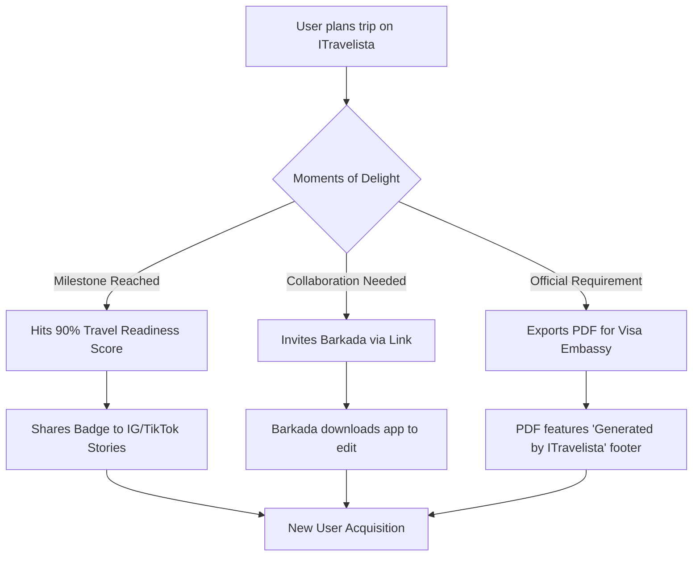

# ITravelista PH: Marketing & Customer Acquisition Playbook

> **Target Audience:** Founding Team & Growth Leads
> **Objective:** Outline a comprehensive, localized customer acquisition strategy tailored to the Philippine market, leveraging product-led growth, micro-communities, and culturally relevant content.

## 1. Executive Summary

ITravelista PH will acquire users by solving the unique friction points of Filipino international travel: visa anxiety, immigration (IO) offloading fears, and strict budgeting constraints. Rather than competing directly on generic travel inspiration, our Go-To-Market (GTM) strategy focuses on **high-intent utility**, **product-led SEO**, and **community-driven virality**. By embedding our tool directly into the research and planning phases of a Filipino traveler's journey, we aim to achieve an LTV:CAC ratio of >3:1 with a strong reliance on organic channels.

## 2. Content Marketing Strategy

Our content strategy mirrors a hybrid of **Wanderlog's product-led SEO**, **TripIt's friction-free onboarding**, and **The Poor Traveler's high-utility dominance**.

| Content Pillar | Competitor Model | Strategy & Execution | Target Audience |
| :--- | :--- | :--- | :--- |
| **Product-Led SEO** | Wanderlog | Programmatic destination pages (e.g., "5D4N Tokyo Itinerary Budget Filipino") with an interactive **"1-Click Import to ITravelista"** CTA. | High-intent planners |
| **Utility & Anxiety Relief** | The Poor Traveler | Step-by-step visa guides and immigration prep. Optimize for long-tail keywords ("how to get Japan visa for Filipinos 2026"). | First-time travelers, Visa applicants |
| **Data-Driven Utility** | Hopper | "Forward email to plans@itravelista.com" to auto-generate itineraries. Shareable predictive budget indices (e.g., "Average PHP spend in Seoul"). | Busy professionals |
| **Viral Inspiration** | TripZilla PH | Listicles ("10 Visa-Free Destinations for Filipinos"), budget breakdowns, and culturally relevant memes. | Top-of-funnel discovery |

> [!TIP]
> **Product-Led Acquisition:** Content pages must never feel like dead ends. Every itinerary, checklist, and budget breakdown hosted on our web domain should immediately deep-link into the app workspace.

## 3. Social Media Strategy

A platform-by-platform breakdown optimized for the Philippine digital landscape:

*   **TikTok (Viral Discovery & Hacks):**
    *   **Focus:** Low-fi, authentic travel hacks, exact PHP budget breakdowns, and IO survival tips.
    *   **Audience:** Gen Z and Millennials.
    *   **Execution:** Screen-record the app showing how easy it is to track group expenses or organize a Schengen visa checklist.
*   **Instagram (Aspirational & Educational):**
    *   **Focus:** Carousel guides, visually appealing Reel itineraries.
    *   **Audience:** Working professionals, DINKs (Double Income, No Kids).
    *   **Execution:** "Save this post for later" mechanics. Shareable 'Travel Readiness' scorecards on IG Stories.
*   **Facebook (Community & Velocity):**
    *   **Focus:** Long-form travelogues, group sharing, and detailed budget reports.
    *   **Audience:** Families, OFWs, multi-generational *barkadas*.
    *   **Execution:** Native video and long-text posts in travel groups with app-download links disguised as "get my exact spreadsheet template here."
*   **YouTube (High-Intent Trust):**
    *   **Focus:** In-depth tutorials (e.g., "Step-by-step Korean Visa Application 2026").
    *   **Audience:** Deep researchers.
    *   **Execution:** Sponsor existing tutorial creators or produce official "ITravelista Masterclasses."

## 4. Influencer & Creator Program Design

Following the highly successful **Klook Kreator Program**, ITravelista will prioritize a vast network of Micro and Nano creators over expensive celebrities.

*   **Target Tier:** Creators with 1K–50K followers (high engagement, localized trust).
*   **Compensation Model:**
    *   **User Perk:** 5-8% promo codes on affiliate bookings (Agoda/Klook) made through the creator's shared itinerary.
    *   **Creator Cut:** 3-5% affiliate commission on transactions generated via their links.
    *   **Incentives:** Top performers unlock sponsored trips and featured placement on the app's discover page.
*   **Campaign Cadence:** Align influencer pushes with standard PH promo cycles—**Payday weekends (15th/30th)** and **Double-Day sales (3.3, 9.9, 11.11)** modeled after Traveloka's "EPIC Sale" livestream format.

## 5. Community Growth Strategy

Filipinos are highly communal travelers. We will infiltrate and provide value to established Facebook and Reddit communities, representing millions of users.

*   **Target Communities:**
    *   *DIY Travel Philippines* (FB - 1.7M+ members): Share high-quality, budget-optimized itineraries generated by the app.
    *   *Japan/Korea/Europe for Pinoys* (FB - 100K-500K each): Deploy "Community Managers" to answer visa queries using ITravelista's visa tracking checklists.
    *   *r/phtravel* (Reddit - 150K+ members): Authentic engagement. Post deep-dive trip reports and IO experiences with soft links to the app.
    *   *OFW / Expat Groups* (Dubai, SG, Qatar, HK): Target multi-destination family meetups and vacation planning.

> [!IMPORTANT]
> **Community Rule of Thumb:** Do not spam. Provide the complete value (the itinerary, the budget) directly in the post natively. The app is offered only as a convenient upgrade ("I built this using ITravelista, here's the import link if you want it").

## 6. App Store Optimization (ASO)

To capture organic App Store and Google Play searches, our metadata and visual presentation must be hyper-localized.

*   **App Title (iOS 30 chars):** `ITravelista: Trip & Visa Planner`
*   **Subtitle (iOS 30 chars):** `Budget Tracker & PH Visa Guide`
*   **Keyword Field:** `travel, itinerary, budget, peso, japan, korea, schengen, immigration, etravel, checklist, offline, planner`
*   **Visual Strategy (The "First 3 Screenshots" Rule):** 80% of users never swipe past the third image.
    1.  *Core USP:* The unified trip dashboard.
    2.  *Anxiety Relief:* The interactive Visa/IO Checklist.
    3.  *Financial Control:* The PHP Budget Donut Chart.
*   **Trust Signals:** Prominently feature ₱ (PHP) symbols, familiar destination imagery (e.g., Tokyo, Seoul), and PH Passport icons.
*   **Rating Triggers:** Prompt for 5-star reviews only at moments of high user delight:
    *   When a Visa Checklist reaches 100%.
    *   When a finalized budget lands *under* the target amount.
    *   24 hours after the trip start date (assuming a positive experience).

## 7. Referral & Viral Mechanics

Growth must be baked into the product experience to achieve our viral loop objectives.

*   **Travel Readiness Score:** A gamified badge ("My Japan Trip is 92% Ready! 🌸") designed specifically for Instagram and TikTok story sharing.
*   **The Visa Export:** Users can export their itinerary and flight details as a clean, embassy-compliant PDF/Excel file, featuring a subtle ITravelista branded footer.
*   **Multi-player Mode:** Group trip invitation links inherently drive the K-factor. One planner forces 3-5 friends to download the app to view the itinerary.

## 8. Partnership & B2B Channels

Leverage established trust networks to acquire users at scale.

*   **Accredited Visa Agencies:** Partner with Reli Tours, Attic Tours, Universal Holidays, and Friendship Tours. Provide them with a co-branded digital pre-screening tool powered by ITravelista.
*   **Offline Activations:** Participate in the **PTAA Travel Tour Expo** (300K+ attendees at SMX). Distribute co-branded QR codes for free itinerary templates.
*   **Financial Institutions:** Collaborate with BPI, BDO, Metrobank, and UnionBank during their travel fairs. Integrate 0% installment awareness or co-branded itinerary features.
*   **E-Wallets:** Deep integration with GCash and Maya to allow automated PHP expense tracking via their travel multi-currency cards.
*   **Tourism Boards:** Joint educational campaigns with JNTO (Japan), KTO (Korea), Taiwan Tourism, STB (Singapore), and HKTB (Hong Kong) for sponsored, verified destination guides.

## 9. Phased Go-To-Market Timeline (Month 1-12)

| Phase | Timeline | Key Focus Areas | Major Milestones |
| :--- | :--- | :--- | :--- |
| **Phase 1: Foundation** | Months 1 - 3 | ASO, Product-Led SEO, Core Content | Launch 50 "1-Click" destination guides; Finalize ASO metadata; Seed r/phtravel. |
| **Phase 2: Community** | Months 4 - 6 | FB Groups, Micro-Creators | Launch Kreator program beta; Deploy FB group community managers; Hit first viral loop. |
| **Phase 3: B2B & Offline** | Months 7 - 9 | Agencies, Tourism Boards | PTAA Expo Activation; Secure 2 Visa Agency partnerships; Launch PDF Export feature. |
| **Phase 4: Scale** | Months 10 - 12| Banks, Double-Day Campaigns | GCash/Maya integrations; Execute 11.11 mega-sale with influencers; scale paid channels. |

## 10. Key Metrics & KPIs to Track

To ensure sustainable growth, the team will monitor the following north-star and secondary metrics:

*   **K-Factor (Virality):** Target **> 0.35** (For every 100 users, they naturally bring in 35 new users via group invites or social sharing).
*   **Day-30 Retention:** Target **> 28%** for users with active/upcoming trips.
*   **Affiliate Conversion Rate:** Benchmark **4-7%** on contextual checklist items (e.g., booking pocket WiFi from the Japan checklist).
*   **LTV:CAC Ratio:** Target **> 3:1**, heavily supported by driving down Customer Acquisition Cost (CAC) through organic SEO and micro-influencer revenue-sharing.
