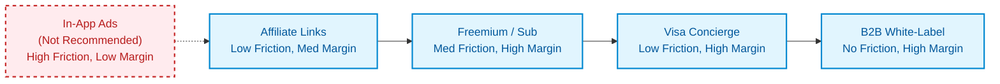

# ITravelista PH: Business Model & Monetization Strategy

## 1. Executive Summary

This document outlines the proposed business model and monetization strategy for ITravelista PH. Given the unique behaviors of the Filipino traveler—specifically, high deal-seeking behavior (59% lead APAC), significant anxiety around visa approval and immigration offloading, and a growing willingness to invest in travel tech—our revenue strategy focuses on high-margin, low-friction streams. 

We recommend a hybrid model emphasizing **contextual affiliate commerce** and **value-added services (Visa Concierge)**, supported by a localized **Freemium subscription**. We explicitly advise against in-app advertising, as it degrades trust in an application designed to hold sensitive travel and financial documents.

## 2. Revenue Model Overview

The monetization spectrum for ITravelista PH moves from low-friction, moderate-margin contextual integrations to high-margin, specialized services. 

## 3. Revenue Stream Deep-Dive

### A. Affiliate Commissions (Contextual Commerce)
- **Revenue Predictability:** Medium
- **User Friction:** Very Low (acts as a value-add to the user experience)
- **Average Yield:** ₱150 – ₱800 ($3 – $15) per active trip
- **Mechanics:** 
  - **Tours/Activities:** When a user adds a destination (e.g., Universal Studios Japan), surface a Klook booking badge.
  - **Connectivity:** Pre-trip checklists trigger Airalo/Holafly eSIM affiliate links.
  - **Insurance & Visas:** Visa Assistant module links to accredited agency partners and travel insurance (Pacific Cross/AXA).

### B. Freemium Subscription (ITravelista Pro)
- **Revenue Predictability:** High (MRR/ARR)
- **User Friction:** Medium (requires paywall conversion)
- **Average Yield:** ₱149/month or ₱799/year
- **Mechanics:** Core planning features remain free. Premium features include AI itinerary generation, real-time multi-user collaboration, and unlimited secure document storage.

### C. Visa Concierge / Document Pre-check Fee
- **Revenue Predictability:** Medium
- **User Friction:** Low to Medium
- **Average Yield:** ₱499 – ₱1,499 per visa pack review
- **Mechanics:** Capitalizing on the high anxiety among Filipinos regarding visa rejections and immigration offloading. Users pay a flat fee for document review, which can be outsourced to accredited partner agencies for fulfillment.

### D. B2B / Agency White-Label & Promoted Placements
- **Revenue Predictability:** High
- **User Friction:** None
- **Average Yield:** ₱15,000 – ₱50,000/month per brand
- **Mechanics:** Premium sponsor slots and integrations for banks, telecom providers, and travel insurance companies within specific app modules.

### E. In-App Ads *(Strategic Exclusion)*
- **Status:** **NOT RECOMMENDED**
- **Average Yield:** ₱10 – ₱30 eCPM
- **Rationale:** High user friction. Degrades perceived quality, security, and trust—critical factors for an app managing sensitive financial and travel documents.

## 4. Pricing Strategy & Tiers

| Tier | Price | Target Audience | Key Features |
|:---|:---|:---|:---|
| **Basic (Free)** | ₱0 | Casual/Budget Travelers | Basic itinerary builder, budget tracker, local checklist, standard affiliate links. |
| **Pro (Monthly)** | ₱149/mo | Occasional Travelers | AI generation, multi-collaborator planning, unlimited document vault. |
| **Pro (Annual)** | ₱799/yr | Frequent Flyers / Digital Nomads | All Pro features + priority Visa Assistant insights. (~55% discount over monthly) |
| **Visa Concierge** | ₱499-₱1,499 | First-time / Anxious Travelers | One-off fee for expert review of visa documents prior to embassy submission. |

## 5. Competitor Pricing Benchmarks

Understanding the global landscape helps position ITravelista PH competitively, especially given the localized pricing sensitivity of the Philippine market.

| Competitor | Pricing Model | Price Point | Focus |
|:---|:---|:---|:---|
| **TripIt Pro** | Subscription | $49/yr (~₱2,700) | Flight tracking & organization |
| **Wanderlog Pro** | Subscription | $40-$50/yr (~₱2,200-₱2,800) | Itinerary & mapping |
| **Splitwise Pro** | Subscription | $40/yr (~₱2,200) | Expense sharing |
| **TravelSpend Premium**| Sub / Lifetime | $18/yr or $40 lifetime | Budget tracking |
| **Sygic Premium** | Subscription | $15/yr (~₱850) | Navigation & routing |
| **Trabee Pocket Pro** | One-time | $3 (~₱170) | Simple expense tracking |
| **iVisa** | Transactional | $30-$150 per visa | Visa processing |
| **VisaHQ** | Transactional | $49-$199 per visa | Visa processing |

> [!NOTE] 
> **Strategic Insight:** ITravelista Pro's proposed ₱799/yr (~$14/yr) undercuts major western tools (TripIt, Wanderlog) significantly, aligning with local purchasing power while maintaining a premium feel.

## 6. Unit Economics Model

*Assumptions based on average Filipino short-haul trip spend (₱42,000 - ₱68,000):*

| Metric | Estimated Value | Notes |
|:---|:---|:---|
| **Customer Acquisition Cost (CAC)** | ₱50 - ₱150 | Driven by organic SEO, TikTok/IG content, and referrals |
| **Average Revenue Per Free User (ARPU)** | ₱250 / active trip | Blended affiliate yield (Klook, eSIM, Insurance) |
| **Average Revenue Per Paid User (ARPU)** | ₱1,050 / year | Subscription (₱799) + Affiliate uplift |
| **Visa Concierge Conversion** | 3% of user base | Assuming ₱999 average margin per transaction |
| **LTV / CAC Ratio** | ~4:1 to 7:1 | Highly dependent on retention and trip frequency |

## 7. Revenue Projections (Year 1-3 Scenarios)

*Based on an aggressive but realistic local adoption curve.*

| Metric | Year 1 | Year 2 | Year 3 |
|:---|:---|:---|:---|
| **Active Users (MAU)** | 50,000 | 150,000 | 400,000 |
| **Paid Conversion Rate** | 1.5% | 2.5% | 4.0% |
| **Pro Subscribers** | 750 | 3,750 | 16,000 |
| **Subscription ARR** | ~₱600K | ~₱3M | ~₱12.7M |
| **Affiliate & Concierge Rev** | ~₱1.2M | ~₱4.5M | ~₱15M |
| **B2B / Sponsorships** | ₱0 | ~₱1.2M | ~₱3.5M |
| **Total Projected Revenue** | **~₱1.8M** | **~₱8.7M** | **~₱31.2M** |

## 8. Partnership & Affiliate Economics

To maximize the contextual commerce strategy, the following partnerships should be prioritized:

| Partner | Category | Commission Structure | Cookie Life | Contextual Trigger |
|:---|:---|:---|:---|:---|
| **iVisa** | Visa/Docs | 20-35% commission | 365 days | User adds restricted destination |
| **Klook** | Activities | 2-8% per booking | 30 days | User adds POI to itinerary |
| **Agoda / Booking** | Hotels | 4-7% on completed stay | 30 days | User creates empty trip dates |
| **Airalo / Holafly**| Connectivity | 10-20% per purchase | 30 days | Pre-trip checklist module |
| **Pacific Cross / AXA**| Insurance | 10-15% gross premium | 30 days | Post-flight booking entry |
| **GCash / Maya** | FinTech | B2B Integration/Bounty | N/A | Budgeting and FX tracking module |

## 9. Risks & Mitigation

| Risk | Impact | Mitigation Strategy |
|:---|:---|:---|
| **Low Subscription Conversion** | High | Ensure core affiliate links remain highly visible to free users. Implement a referral program (e.g., "Invite a friend, get 1 month Pro free"). |
| **Affiliate Tracking Breakage** | High | Use robust server-side tracking where possible. Regularly audit affiliate links and rely on API integrations rather than raw links. |
| **Visa Concierge Liability** | Critical | Clear terms of service stating we *review* documents but do not *guarantee* embassy approval or immigration clearance. Use vetted 3rd party agencies. |
| **Seasonal Travel Slumps** | Medium | Promote "staycation" and domestic travel planning features during international off-seasons to maintain engagement. |

## 10. Recommended Revenue Stack & Phasing

**Phase 1: Market Penetration (Months 1-6)**
- **Focus:** User acquisition and data collection.
- **Revenue:** 100% Affiliate Commissions.
- **Action:** Integrate Klook, Agoda, and Airalo natively into the itinerary builder. Keep the app completely free to maximize viral loop and user growth.

**Phase 2: Premium Validation (Months 7-12)**
- **Focus:** Monetizing power users and solving high-friction problems.
- **Revenue:** Affiliate + ITravelista Pro Subscriptions.
- **Action:** Introduce the ₱799/yr Pro tier gated behind AI generation and multi-user collaboration. Launch the beta for the Visa Concierge document pre-check.

**Phase 3: B2B Expansion (Year 2+)**
- **Focus:** Enterprise margins and ecosystem dominance.
- **Revenue:** Affiliate + Pro + Concierge + B2B.
- **Action:** Pitch anonymized travel intent data to local banks (BPI, BDO) and airlines (Cebu Pacific, PAL) for targeted, white-labeled in-app placements. Scale the Visa Concierge via accredited agency partnerships.
